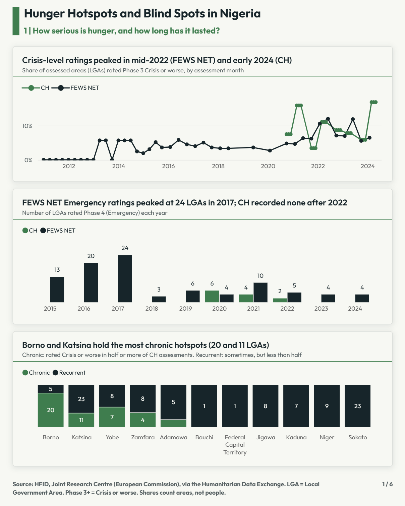

# Hunger Hotspots and Blind Spots in Nigeria

*36 states and the Federal Capital Territory. 2011 to 2024.*

**Next project:** [Predicting Hunger in Nigeria](https://github.com/roundedoj/predicting-hunger-nigeria): can machine learning predict these crises?

**The question.** Where is hunger in Nigeria worst, where does it last, and where can't we see it?

**What the data shows**
- The North East had the highest share every year, while the North West had a sharp rise in 2024.
- **43** LGAs were rated Crisis or worse in at least half of their assessments; 31 are in Borno and Katsina.
- In March to May 2024, over **80%** of assessed LGAs in Yobe and Borno were in Crisis or worse.
- Poor diets reached **57%** (state average) in February 2024, up from 27% in October 2022.
- **9** states have no household survey data; 4 rely on a single source.

**See it:** [Full report (PDF)](docs/HFID_Nigeria_Analysis.pdf) · [How it was built](docs/PROCESS.md)

**The pipeline**
`HFID CSV (311,838 rows, 80 countries)` → `Excel Power Query: filter Nigeria, clean, derive` → `49,163 × 17 table` → `Power BI: Date table, 28 DAX measures` → `6-page report`

**Inside this repo**
- `docs/` report PDF and full process documentation
- `data/` cleaned Nigeria table (Power Query steps saved inside)
- `powerbi/` report file and colour/font theme
- `images/` report pages

**Reproduce it:** download HFID from the [Humanitarian Data Exchange](https://data.humdata.org/dataset/harmonized-food-insecurity-dataset-hfid), then follow `docs/PROCESS.md`. Install the free Outfit font (Google Fonts) to see the intended design in the `.pbix`.

**Limitations:** shares count areas, not people; survey values are state-level; blanks mean "not assessed"; descriptive analysis, not causal.

**Data credit:** Harmonized Food Insecurity Dataset (HFID), Joint Research Centre of the European Commission, via HDX, CC BY 4.0.

**Author:** Justice Chikesirim Obisike · [LinkedIn](https://www.linkedin.com/in/justice-obisike-65821a24b/) · Developed with assistance from Claude (Anthropic)
